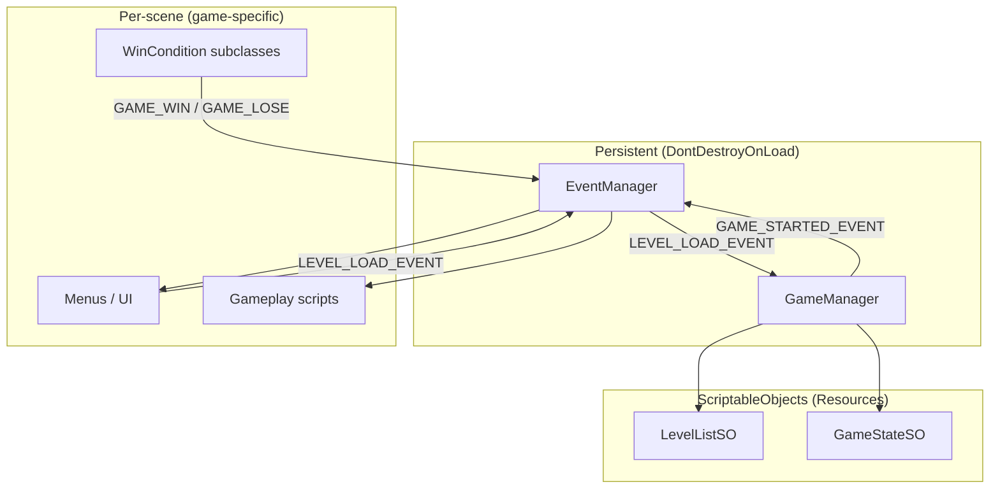
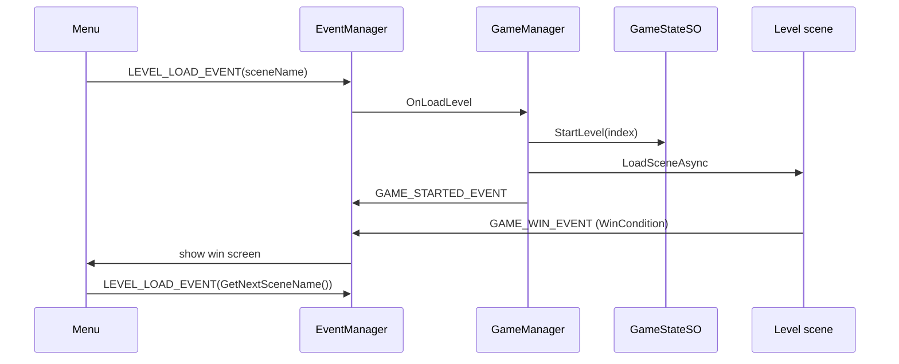

# Architecture

This project is a Unity template that holds the game-loop pieces any game can reuse: an event bus, scene loading, level data and a win/lose hook. Anything game-specific (player, input, camera, UI) is built on top of it.

## Layout

```
SampleProject/Assets/
  Scripts/
    Core/                          Reusable template code
      EventManager.cs              Global publish/subscribe event bus
      GameManager.cs               Loads scenes and announces when a level has started
      Bootstrapper.cs              Spawns the manager prefabs before the first scene loads
      SingletonScriptableObject.cs Base class for ScriptableObjects loaded from Resources
    Data/                          Reusable template code
      LevelListSO.cs               Title scene, selection scene and the ordered level list
      GameStateSO.cs               Current level index and completion results
    Gameplay/                      Reusable template code
      WinCondition.cs              Abstract base for win/lose rules
    UI/                            Reusable template interface (UI Toolkit)
      UIScreen.cs                  Base class: Show/Hide, LoadScene, FormatTime
      TitleMenuController.cs       Start / Quit
      SelectionScreenController.cs Level picker (optional rotating preview prefab)
      GameOverlayController.cs     HUD: timer + move count; saves the results to GameStateSO
      PauseMenuController.cs       ESC pauses and resumes
      WinScreenController.cs       Results, Next / Retry / Menu
      LoseScreenController.cs      Retry / Menu
    CubeGame/                      Sample game that tests the template (replace this per project)
      CubePlayer.cs                Rolling cube driven by WASD/arrow keys
      CubeRules.cs                 WinCondition: win on the goal tile, lose when off the grid
  Editor/
    TemplateSetup.cs               Tools > Template > Build Sample Content
  UI/                              UXML layouts, Common.uss, Theme.tss, PanelSettings
  Resources/
    Managers/                      EventManager and GameManager prefabs
    LevelListSO.asset, GameStateSO.asset
```

## Overview



Different layers never reference each other directly. They talk through `EventManager`, and shared data lives in the ScriptableObjects.

## Components

### EventManager
A singleton that survives scene loads and maps each `Event` enum value to a list of listeners.

```csharp
EventManager.StartListening(Event.GAME_WIN_EVENT, OnWin);
EventManager.StopListening(Event.GAME_WIN_EVENT, OnWin);
EventManager.TriggerEvent(Event.LEVEL_LOAD_EVENT, new Dictionary<string, object> { { "sceneName", "Level1" } });
```

Every payload is a `Dictionary<string, object>`, which may be `null`. Subscribe in `Awake`/`OnEnable` and unsubscribe in `OnDestroy`/`OnDisable`.

### GameManager
A singleton that survives scene loads. When it receives `LEVEL_LOAD_EVENT`:
1. It looks the scene up in `LevelListSO`. If the scene is a level, it calls `GameStateSO.StartLevel(index)`.
2. It loads the scene asynchronously.
3. It fires `GAME_STARTED_EVENT` with `sceneName`.

### SingletonScriptableObject&lt;T&gt;
Exposes `T.Instance`, which loads the asset from any `Resources` folder by its type name. The asset therefore has to be named exactly `LevelListSO` / `GameStateSO`.

### LevelListSO
Holds `titleScene`, `selectionScene` and `levels`, a list of `LevelEntry { sceneName, previewPrefab }`. A level's position in this list is its index.

### GameStateSO
Holds the state for the current run: `CurrentLevelIndex`, `CompletionTime` and `CompletionMoveCount`. It also provides `GetCurrentSceneName()` and `GetNextSceneName()`; the latter returns `null` on the last level. These are useful for Retry and Next buttons.

### WinCondition
An abstract `MonoBehaviour`. Subclasses subscribe to the game's own events in `OnEnable`/`OnDisable` and call `DeclareWin()` or `DeclareLose()`.

## Events

| Event | Fired by | Payload | Typical listeners |
|---|---|---|---|
| `LEVEL_LOAD_EVENT` | Menus, retry/next buttons | `sceneName` | `GameManager` |
| `GAME_STARTED_EVENT` | `GameManager` | `sceneName` | HUD (reset timer), input (unlock) |
| `GAME_WIN_EVENT` | `WinCondition` | none | Win screen, HUD (stop timer), input (lock) |
| `GAME_LOSE_EVENT` | `WinCondition` | none | Lose screen, HUD, input |
| `GAME_PAUSE_EVENT` | Pause menu | none | Input (lock) |
| `GAME_RESUME_EVENT` | Pause menu | none | Input (unlock) |
| `PLAYER_MOVED_EVENT` | Player | `count` (int), `position` (Vector3) | HUD, `WinCondition` |

To add game-specific events, append values to the `Event` enum.

## Game flow



## UI

Each screen is a GameObject with a `UIDocument` and a `UIScreen` subclass. All screens share `UI/PanelSettings.asset`, and `sortingOrder` sets how they stack: HUD 0, pause 10, win/lose 20. Styles live in `UI/Common.uss`, which `UI/Theme.tss` loads on top of Unity's default theme.

The order of subscriptions matters at the end of a game. The HUD subscribes in `Awake` and saves the results to `GameStateSO`. The win/lose screens subscribe in `Start`, so they always read the results after they have been saved.

## Managers

You don't have to place `EventManager` and `GameManager` in any scene. `Bootstrapper` spawns them from `Resources/Managers/` before the first scene loads, so pressing Play in any scene works.

## Setup

1. Open the project and run **Tools > Template > Build Sample Content**. It creates:
   - the manager prefabs, `LevelListSO` and `GameStateSO`
   - `PanelSettings` and the materials
   - the scenes `Title`, `Selection` and `Level1`–`Level3`, all added to Build Settings

   Running it again overwrites everything it generated.
2. Open `Title` and press Play. Move with WASD or the arrow keys and pause with ESC.

## Starting a new game from the template

1. Delete `Scripts/CubeGame`, the level scenes and `Editor/TemplateSetup.cs` (or change its level builder).
2. Add game-specific values to the `Event` enum.
3. Write a `WinCondition` subclass and a player that fires `PLAYER_MOVED_EVENT` (or your own events).
4. Fill in `LevelListSO` with your scenes and add each one to Build Settings.
